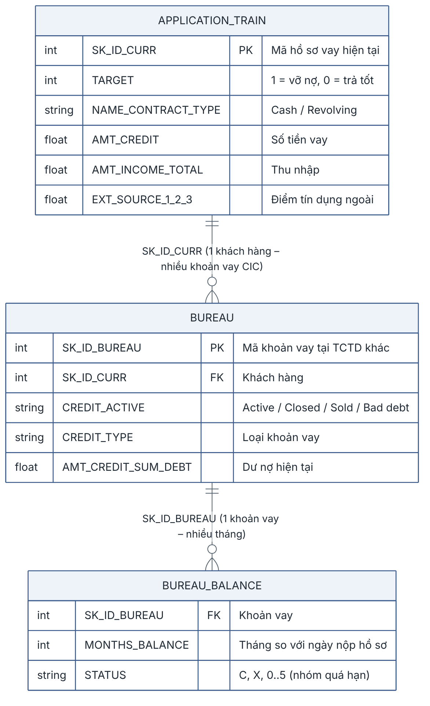
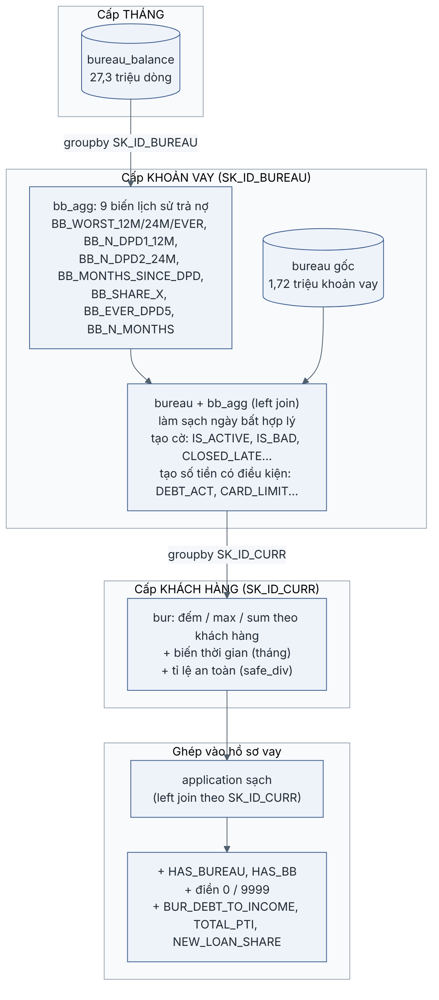
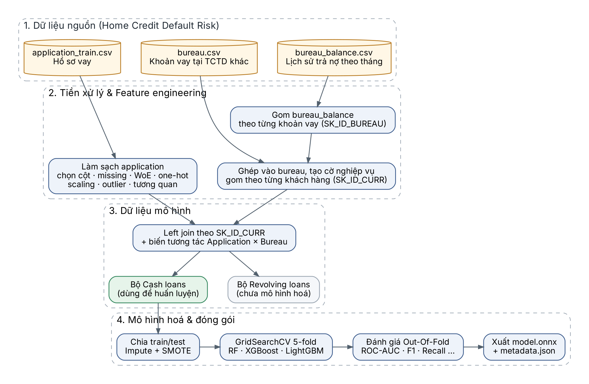
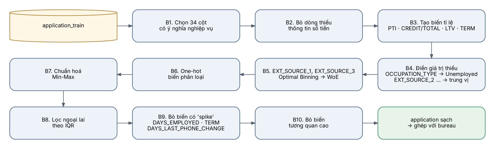
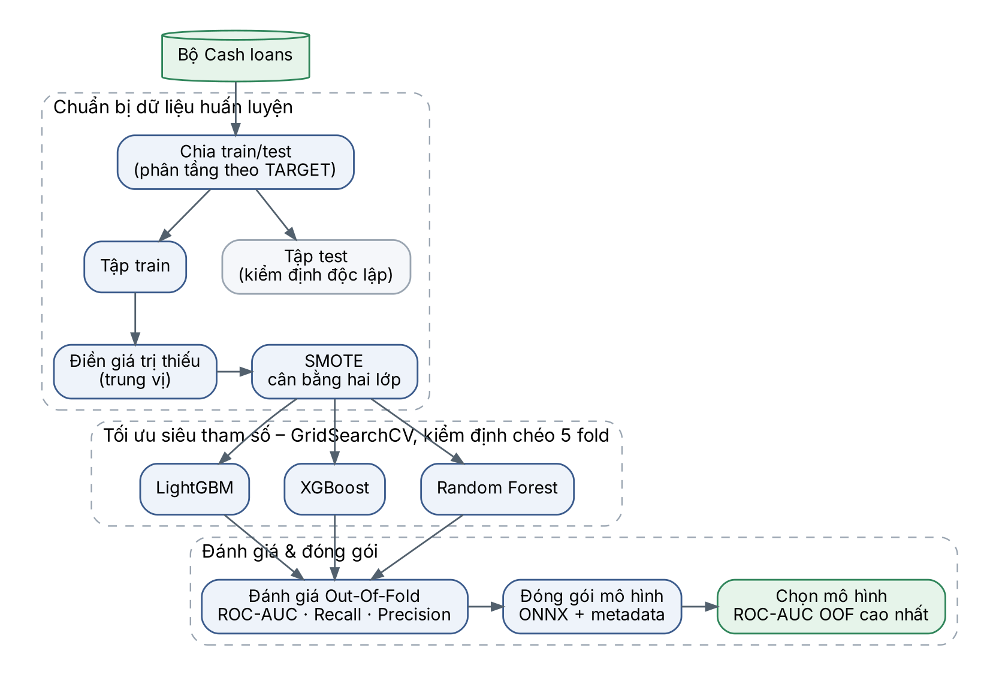

# Dự đoán rủi ro vỡ nợ tín dụng (Credit Default Risk)

Dự án xây dựng mô hình dự đoán khả năng **vỡ nợ** của khách hàng vay **tiền mặt (Cash loans)**. Dữ liệu dùng là bộ [Home Credit Default Risk](https://www.kaggle.com/c/home-credit-default-risk) trên Kaggle.

Bài toán có **nhãn mất cân bằng nặng**: chỉ khoảng 8,35% hồ sơ vỡ nợ, tức khoảng 11 hồ sơ tốt mới có 1 hồ sơ vỡ nợ.

Toàn bộ quy trình nằm trong một notebook duy nhất là `main.ipynb`. Quy trình gồm EDA, tiền xử lý, gộp dữ liệu, xử lý lệch nhãn, huấn luyện RandomForest / XGBoost / LightGBM, export ONNX và giải thích mô hình bằng SHAP.

---

## 1. Dữ liệu

Các file đặt trong thư mục `data/`:

| File | Số dòng | Mô tả |
|---|---|---|
| `application_train.csv` | 307,511 | Hồ sơ vay + nhãn `TARGET` (1 = vỡ nợ) |
| `bureau.csv` | 1,716,428 | Các khoản vay của khách hàng tại tổ chức tín dụng khác (CIC) |
| `bureau_balance.csv` | 27,299,925 | Trạng thái quá hạn theo tháng của từng khoản vay trong `bureau` |
| `HomeCredit_columns_description.csv` | – | Mô tả ý nghĩa các cột |
| `sample_submission.csv` | – | File mẫu nộp bài của Kaggle (không sử dụng) |

Quan hệ giữa 3 bảng: 1 hồ sơ vay ứng với nhiều khoản vay CIC, và 1 khoản vay CIC ứng với nhiều tháng lịch sử.



Notebook **chỉ dùng 3 bảng** `application_train`, `bureau` và `bureau_balance`. Các bảng khác của cuộc thi không có trong dự án, gồm `previous_application`, `installments_payments`, `POS_CASH_balance` và `credit_card_balance`.

## 2. Môi trường & cách chạy

Dự án dùng conda env `python3.10`, nằm ở `/home/minora/miniconda3/envs/python3.10`. Các thư viện chính:

`pandas 2.3`, `numpy 2.2`, `scikit-learn 1.7`, `imbalanced-learn 0.14`, `xgboost 3.2`, `lightgbm 4.7`, `skl2onnx`, `onnxmltools`, `onnxruntime`, `shap 0.49`, `tabulate`, `matplotlib`, `seaborn`

Lệnh chạy toàn bộ notebook, kết quả ghi thẳng vào `main.ipynb`:

```bash
/home/minora/miniconda3/envs/python3.10/bin/python -m jupyter nbconvert --to notebook --execute --inplace main.ipynb --ExecutePreprocessor.timeout=-1
```

- **Thời gian chạy:** khoảng 22 phút trên CPU 12 nhân.
- **RAM:** dùng tối đa khoảng 6 GB.
- **Thứ tự chạy:** các cell phải chạy từ trên xuống dưới vì dùng chung biến.

## 3. Quy trình xử lý (`main.ipynb`)

| Mục | Nội dung |
|---|---|
| **1. Application** | Chọn cột có ý nghĩa nghiệp vụ. Thay `DAYS_EMPLOYED = 365243` (mã của người hưu trí) bằng NaN. Tạo các đặc trưng tỉ lệ (`PTI`, `CREDIT/TOTAL`, `LTV`, `TERM`, `EMPLOYED_TO_AGE`, `INCOME_PER_PERSON`...) và tổng hợp EXT_SOURCE (mean / min / max / std / prod). One-hot các biến phân loại. Giữ NaN để mô hình cây tự xử lý. |
| **2. Bureau** | Chỉ chuyển các giá trị sai logic thành NaN, ví dụ ngày kết thúc trước ngày mở hay dư nợ âm. **Không xóa dòng, không điền median, không chuẩn hóa.** |
| **3. Bureau_balance** | Gom về mỗi khoản vay một dòng: mức quá hạn tệ nhất trong 12 tháng, 24 tháng và từ trước đến nay, số tháng quá hạn, số tháng kể từ lần quá hạn gần nhất, tỉ lệ trạng thái X/C... |
| **4. Merge** | Gom bureau về cấp khách hàng thành các biến `BUR_*`, `BB_*` và thống kê mean/max. Join vào application, rồi tạo biến tương tác (`TOTAL_PTI`, `BUR_DEBT_TO_INCOME`, `NEW_LOAN_SHARE`). Tách bộ **Cash loans** để mô hình hóa: 278,220 hồ sơ, 221 đặc trưng. |
| **5. Xử lí lệch nhãn** | Tách tập test hold-out 20% **trước** mọi bước khác. So sánh 4 chiến lược bằng 5-fold CV trên tập train. |
| **6. Trainning model** | GridSearchCV (3-fold, ROC-AUC) cho RF, XGBoost và LightGBM. Chọn ngưỡng quyết định tối ưu F1 trên dự đoán OOF. Đánh giá **một lần** trên tập test. Export ONNX và kiểm tra lại kết quả ONNX. |
| **7. Stacking** | Logistic Regression học trên log-odds OOF của 3 mô hình. |
| **8. Kiểm tra yêu cầu** | Precision / Recall / F1 > 0.8 cho cả 2 lớp, kèm bảng đánh đổi ngưỡng. |
| **9. SHAP** | Giải thích mô hình, đóng góp theo nguồn dữ liệu, các nhóm khách hàng mô hình dự đoán yếu, phân tích ca vỡ nợ bị bỏ sót. |
| **10. Kết quả cuối cùng** | Bảng tổng kết và mô hình đề xuất triển khai. |

Sơ đồ ghép dữ liệu bureau, gom từ cấp tháng lên cấp khoản vay rồi lên cấp khách hàng. Phiên bản hiện tại bổ sung thêm các thống kê mean/max và giữ NaN cho các thống kê này:



### Các lỗi đã sửa so với phiên bản ban đầu

Các sơ đồ dưới đây mô tả **pipeline ban đầu (trước khi sửa)**, để đối chiếu với bảng lỗi phía sau.

<details>
<summary>Sơ đồ pipeline ban đầu</summary>







</details>

| Vấn đề | Cách sửa |
|---|---|
| WoE (OptBinning) và MinMaxScaler fit trên **toàn bộ dữ liệu** trước khi chia train/test, gây **rò rỉ nhãn** | Bỏ cả hai. Mô hình cây không cần chuẩn hóa và tự xử lý NaN. |
| `DAYS_EMPLOYED = 365243` bị xem là "spike" nên bỏ cả cột | Đổi mã này thành NaN và giữ cột. |
| Xóa outlier bằng IQR và bỏ cột `TERM`. Ở bureau, cách này xóa mất **18% số dòng** | Giữ toàn bộ dữ liệu. Outlier là khách hàng thật (nhóm outlier có tỉ lệ vỡ nợ khác biệt), còn `TERM` là đặc trưng quan trọng thứ 2. |
| `OCCUPATION_TYPE` bị thiếu được gán là `Unemployed` | Gán thành `Not declared`, vì phần lớn trường hợp này là người hưu trí chứ không phải người thất nghiệp. |
| SMOTE chạy xong nhưng không dùng. Nếu áp SMOTE trước khi chia CV thì sẽ rò rỉ dữ liệu | Đưa SMOTE vào **imblearn Pipeline** để chỉ áp lên fold huấn luyện. |
| Không có tập test riêng, GridSearch và OOF dùng chung các fold | Tách tập test hold-out 20% ngay từ đầu. |
| Dùng ngưỡng mặc định 0.5 | Chọn ngưỡng theo dự đoán OOF của tập train. |

## 4. Xử lý dữ liệu lệch nhãn

So sánh bằng 5-fold CV trên tập train, cùng một cấu hình LightGBM:

| Chiến lược | ROC-AUC | PR-AUC | Precision@0.5 | Recall@0.5 | F1@0.5 |
|---|---|---|---|---|---|
| Không xử lý | 0.7712 | 0.2673 | 0.5602 | 0.0354 | 0.0665 |
| Class weight | 0.7702 | 0.2671 | 0.1883 | 0.6553 | 0.2925 |
| SMOTE (trong Pipeline) | 0.7703 | 0.2643 | 0.5721 | 0.0332 | 0.0627 |
| Random Undersampling | 0.7670 | 0.2584 | 0.1745 | 0.6929 | 0.2788 |

**Kết luận:** xử lý lệch nhãn **không làm tăng khả năng phân biệt** của mô hình, vì ROC-AUC gần như không đổi giữa các chiến lược. Nó chỉ dịch chuyển xác suất dự đoán. Vì vậy dự án chọn **class weight** (`scale_pos_weight` / `class_weight`) kết hợp **chọn ngưỡng quyết định tối ưu trên OOF**.

## 5. Kết quả cuối cùng

Đánh giá trên tập test hold-out gồm 55,644 hồ sơ, giữ nguyên tỉ lệ vỡ nợ thật 8.35%. Ngưỡng tối ưu F1 được chọn từ OOF của tập train.

| Model | ROC-AUC | Gini | KS | PR-AUC | Accuracy | Precision lớp 1 | Recall lớp 1 | F1 lớp 1 |
|---|---|---|---|---|---|---|---|---|
| Pipeline ban đầu | 0.7560 (OOF) | – | – | – | 0.7051 | 0.1732 | 0.6700 | 0.2753 |
| RandomForest | 0.7579 | 0.5158 | 0.3873 | 0.2393 | 0.8324 | 0.2360 | 0.4507 | 0.3098 |
| XGBoost | 0.7793 | 0.5585 | 0.4197 | 0.2727 | 0.8564 | 0.2701 | 0.4236 | 0.3299 |
| **LightGBM** | **0.7801** | **0.5602** | **0.4234** | **0.2754** | 0.8518 | 0.2673 | 0.4453 | **0.3340** |
| Stacking | 0.7805 | 0.5610 | – | 0.2753 | – | 0.2714 | 0.4272 | 0.3319 |

**Mô hình đề xuất triển khai: LightGBM.** Tham số `num_leaves = 24`, `min_child_samples = 400`, `learning_rate = 0.02`, `n_estimators = 1400`, ngưỡng quyết định 0.6582. Stacking chỉ hơn +0.0004 ROC-AUC nhưng phải chạy cả 3 mô hình nên không được chọn.

| Lớp | Precision | Recall | F1 | Số hồ sơ |
|---|---|---|---|---|
| 0 - Không vỡ nợ | 0.9462 | 0.8888 | 0.9166 | 51,000 |
| 1 - Vỡ nợ | 0.2673 | 0.4453 | 0.3340 | 4,644 |

Confusion matrix: TN = 45,330, FP = 5,670, FN = 2,576, TP = 2,068.

### Bảng đánh đổi ngưỡng (Stacking, tập test)

Ngưỡng được chọn theo khẩu vị rủi ro, không cố định ở mức tối ưu F1:

| Recall lớp 1 mục tiêu | Tỉ lệ hồ sơ bị từ chối | Tỉ lệ vỡ nợ trong nhóm được duyệt | Precision lớp 1 | Recall lớp 1 |
|---|---|---|---|---|
| 0.3 | 8.0% | 6.3% | 0.322 | 0.309 |
| 0.5 | 18.4% | 4.8% | 0.239 | 0.527 |
| 0.7 | 34.3% | 3.4% | 0.178 | 0.729 |
| 0.9 | 62.9% | 2.0% | 0.121 | 0.911 |

Ví dụ: từ chối khoảng 18% hồ sơ rủi ro nhất thì bắt được khoảng 53% ca vỡ nợ, và tỉ lệ vỡ nợ của nhóm được duyệt giảm từ **8.35% xuống khoảng 4.8%**.

## 6. Giải thích mô hình (SHAP) & hướng cải thiện

Phân tích được chạy trên LightGBM, với 10,000 hồ sơ lấy ngẫu nhiên từ tập test.

| Nguồn dữ liệu | Số đặc trưng | Tỉ trọng đóng góp |
|---|---|---|
| Application (hồ sơ vay) | 147 | 51.0% |
| Bureau (khoản vay tại tổ chức khác) | 57 | 26.6% |
| Điểm tín dụng ngoài (EXT_SOURCE) | 8 | 22.1% |
| Bureau balance (lịch sử theo tháng) | 9 | 0.3% |

1. **EXT_SOURCE** là nhóm quan trọng nhất. `EXT_SOURCE_MEAN` đứng đầu, quan hệ đơn điệu: điểm càng thấp thì rủi ro càng cao.
2. **TERM** (`AMT_CREDIT / AMT_ANNUITY`) đứng thứ 2 với dạng SHAP răng cưa. Nhiều khả năng nó đang gián tiếp mã hóa **kỳ hạn và lãi suất** của từng gói vay, là thông tin không có trong dữ liệu.
3. **Bureau balance** gần như không thêm thông tin. **51/221 đặc trưng** gần như không được mô hình dùng tới.
4. **Nhóm mô hình dự đoán yếu nhất là khách hàng không có lịch sử CIC.** Nhóm này chiếm 14% hồ sơ và có tỉ lệ vỡ nợ cao nhất (10.3%), nhưng ROC-AUC chỉ 0.745, so với 0.785 ở nhóm có CIC.
5. **Các ca vỡ nợ bị bỏ sót trông giống khách hàng tốt.** `EXT_SOURCE_MEAN` trung bình của nhóm này là 0.49, so với 0.29 ở các ca bắt được. Với thông tin hiện có thì không phân biệt được những ca này.

**Hướng cải thiện, xếp theo hiệu quả kỳ vọng:**
- Bổ sung dữ liệu **hành vi trả nợ**: lịch sử trả góp, thẻ tín dụng, các khoản vay trước.
- Bổ sung **kỳ hạn và lãi suất thực** của khoản vay, để thay cho TERM.
- Với khách hàng **không có CIC**, dùng dữ liệu thay thế (viễn thông, điện nước, xác minh thu nhập) hoặc một quy trình thẩm định riêng.
- Về vận hành, dùng mô hình như **điểm rủi ro hoặc phân hạng**, chọn ngưỡng theo chi phí, và theo dõi Gini / KS.
